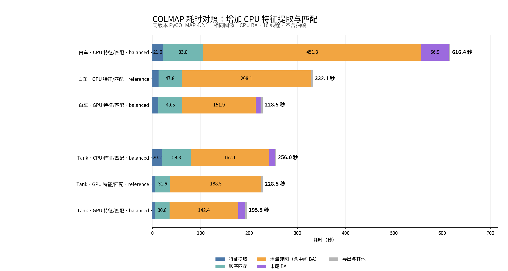

# vggt-gen-v2 验证记录

## 开关与环境

`--sfm-profile reference|balanced` 同时适用于 `python -m gen_pro run` 和 `scripts/run_traj_reconstruction.py`。两版保留全帧、共享 OPENCV 相机、SIFT 长边 1600、顺序重叠 15 和二次重叠；局部与中间全局 BA 的迭代上限分别为 25/50。

| 配置 | 全局帧数/点数增长触发比例 | 最大细化轮数 | 末尾 BA 迭代上限 |
| --- | ---: | ---: | ---: |
| reference | 1.1 | 5 | 无额外 BA |
| balanced | 1.3 | 2 | 100 |

测试机器使用 RTX A6000、16 个 CPU 线程；GPU SIFT 运行时为独立的官方 `pycolmap-cuda12==4.2.1` 环境，默认 CPU BA。下列数据均为单次测量。除了明确列出的原视频完整运行，其余复用相同 JPEG，不包含视频解码。

## 分阶段耗时

单位：秒。CPU/GPU 列仅表示特征提取和匹配设备，所有组的 BA 均在 CPU 上。

| 场景 | 特征设备 | 调度 | 提取 | 匹配 | Mapper（含中间 BA） | 末尾 BA | 总计（含其他开销） |
| --- | --- | --- | ---: | ---: | ---: | ---: | ---: |
| 白车 125 帧 | GPU | reference | 12.6 | 47.8 | 268.1 | — | 332.1 |
| 白车 125 帧 | GPU | balanced | 12.3 | 49.5 | 151.9 | 10.4 | 228.5 |
| 白车 125 帧 | CPU | balanced | 21.6 | 83.8 | 451.3 | 56.9 | 616.4 |
| Tank 120 帧 | GPU | reference | 5.4 | 31.6 | 188.5 | — | 228.5 |
| Tank 120 帧 | GPU | balanced | 4.6 | 30.8 | 142.4 | 14.5 | 195.5 |
| Tank 120 帧 | CPU | balanced | 20.2 | 59.3 | 162.1 | 12.1 | 256.0 |

在 GPU SIFT 条件下，balanced 比 reference 分别减少 31.2% 和 14.5% 的总耗时。仅比较提取+匹配，GPU 相对 CPU 分别提速 1.70× 和 2.24×。CPU/GPU 实现得到的特征和匹配不同，白车整段 2.70× 的时间差还包含后续建图及 BA 收敛变化，不能作为纯 GPU 算子提速；tank 整段为 1.31×。

另有 COLMAP 3.9.1 的历史 CPU 日志：白车 120 帧提取/匹配/mapper 为 24.36/325.08/435.66 秒，tank 为 32.94/416.40/471.06 秒。版本与白车帧数不同，未用于上述收益计算。

## 相机与失败方案

比较前先按共同相机中心进行 Sim(3) 对齐。采用与同版本 reference 的一致性阈值：指定参考图全部注册；全帧组注册数不下降；重投影误差不超过 max(基线×1.05, 基线+0.05px)；旋转差 P95≤0.3°；相机中心差 P95≤分布尺度的 0.5%。分布尺度为相机中心到其均值的距离中位数。这些是与基线的一致性检查，没有真值精度保证。

- GPU balanced 两场景均通过。相机数分别保持 125/99，六张指定图均保留；旋转差 P95 为 0.034°/0.037°，中心差 P95 为分布尺度的 0.072%/0.065%。
- CPU 特征白车组旋转差 P95 为 0.403°，超出原调度一致性阈值；其余检查通过。没有真值，不能据此认定 CPU 相机更差。该组主要用于性能对照；tank CPU 特征组通过全部检查。
- 白车关键帧 60/90 组分别耗时 74.5/153.9 秒，但中心差 P95 约为 1.61%/1.20%，未通过一致性检查。tank 关键帧子集注册不足，回退后耗时 503.7 秒，比全帧更慢。
- 连续补注册两张新图时，相机数 60→61→62，已有位姿最大变化约 3.55e-15；补注册使用固定原位姿/内参的末尾 BA。

## 原视频与后续流程

从白车原始视频运行第一步，耗时 269.8 秒：抽帧 48.0 秒、COLMAP 221.4 秒，125/125 相机注册。125 张 JPEG 与固定帧实验逐字节相同。仍保留原相机光轴会聚不紧的提示，后续来源图步骤使用 SAM3 掩码中心将相机转向物体。未与旧 CPU 全流程做同条件计时，不报告新旧完整流程倍数。

白车 GPU balanced 的六张来源图、SAM3、Omega 初始化与轨迹导出全部通过，点云投影落入掩码比例为 0.881/0.826/0.840/0.878/0.959/0.981。沿用旧实验物理目标轨迹，重新生成 80 帧（832×480、50 步、seed=20261030），重新计算 80 张掩码，完成 49,375 步 pose_refine 训练，耗时约 29.2 分钟。

| 中位数指标 | 规划相机 | 修正相机 |
| --- | ---: | ---: |
| 前景 PSNR | 17.53 dB | 31.02 dB |
| 轮廓 IoU | 0.925 | 0.953 |

指标使用新生成图和掩码评估，不是独立真实留出集。旧流程为 COLMAP 3.9，本次也重新生成了图像，因此不是仅改变 BA 调度的视觉单变量实验；部分角度仍有变形和残影，不能声称飘逸完全解决。v1 固定输入的真实留出验收另见 [历史记录](white_car_e1_v1_validation.md)。

## GPU BA 与发布检查

另外编译 COLMAP 4.2.1 + Ceres 2.2.0 + CUDA 12.8，实际 Ceres 摘要确认 125 相机问题使用 CUDA DENSE_SCHUR，未启用 cuDSS。同一源码构建的 CPU/GPU BA 总耗时：白车 230.5/248.2 秒，tank 208.3/193.6 秒，收益不稳定，默认仍用 CPU BA。官方 CUDA wheel 并不支持 Ceres CUDA BA；`--sfm-ba-device cuda` 会在能力不满足时提前报错。

v2 发布检查：62 项 CPU 回归测试通过；`vggt_diff-0.2.0-py3-none-any.whl` 构建成功；从解包目录验证了 reconstruction 配置、reference/balanced 调度、profile CLI 与独立 CUDA worker probe。`git diff --check` 通过。机器可读实测指标见 [benchmark.json](../results/sfm_v2/benchmark.json)。视频、权重和本机运行环境保持在本地，代码包不包含这些大文件。
