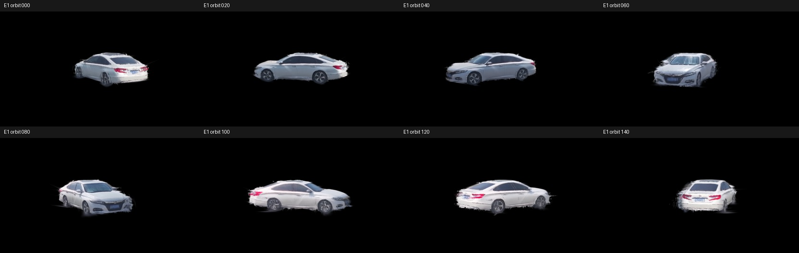

# 白车 E1 复现结果

固定旧生成图、掩码、相机和初始化，重新训练 49,375 步；2026-10-28 在 RTX A6000 上完成，耗时约 20.4 分钟。完整输入、模型及视频保留在本地。

原实验的 160 个独立环绕相机，每隔 20 个机位选一张，未按质量挑选。

| 数据集 / 指标（中位数） | 旧 E1 | 本次复现 | 差值 | 容差 |
| --- | ---: | ---: | ---: | ---: |
| 训练 79 视角 / 前景 PSNR (dB) ↑ | 24.39388 | 24.24798 | -0.14591 | ±0.5 |
| 训练 79 视角 / 轮廓 IoU ↑ | 0.90585 | 0.90367 | -0.00218 | ±0.02 |
| 训练 79 视角 / 轮廓外不透明度 / 掩码面积 ↓ | 0.10322 | 0.10303 | -0.00018 | ±0.03 |
| 独立真实 16 视角 / 前景 PSNR (dB) ↑ | 17.73998 | 17.74975 | +0.00978 | ±0.5 |
| 独立真实 16 视角 / 轮廓 IoU ↑ | 0.88703 | 0.88629 | -0.00074 | ±0.02 |
| 独立真实 16 视角 / 轮廓外不透明度 / 掩码面积 ↓ | 0.10885 | 0.10920 | +0.00035 | ±0.03 |

六项检查全部通过。高斯数量：旧 E1 为 77,270，本次为 76,451。训练集衡量拟合，16 张真实留出图与六张源图不重合；其结果不代表未观测侧面几何已有完整真值验证。

[benchmark.json](benchmark.json) 保留全部 79 + 16 个视角的三项指标及验收结果；[旧实验逐视角数据](../../examples/white_car/evaluation/reference_metrics.json) 可用于对照。

这些指标来自固定旧生成图。另一次重新生成与旧图的全图 PSNR 中位数为 49.09 dB，存在小幅像素差异；尚未用该批新图重新训练验证。

[复现命令](../../examples/white_car/README.md) · [验证记录](../../docs/white_car_e1_v1_validation.md)
